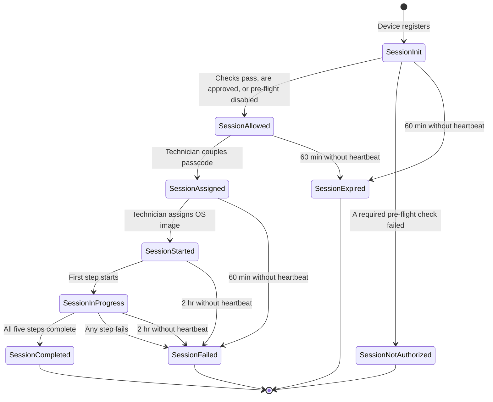
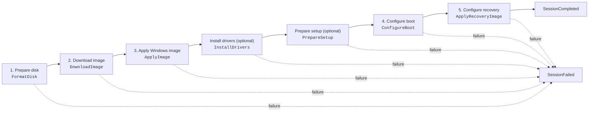

# Session lifecycle

A session represents one attempt to image one device. Imaging Core owns its state, while the Client and Portal drive transitions through the Device Gateway and Operator APIs.

## State diagram

This diagram is adapted from the engineering sequence diagrams and aligned with the current implementation.

`SessionInit` is the initial state while pre-flight authorization is evaluated. The persisted session normally reaches `SessionAllowed` or `SessionNotAuthorized` as part of registration.

## State reference

| State | Meaning | Next state |
|---|---|---|
| `SessionInit` | Registration and pre-flight authorization are being evaluated | `SessionAllowed`, `SessionNotAuthorized`, or `SessionExpired` |
| `SessionAllowed` | Device may be imaged and is waiting for its passcode to be coupled | `SessionAssigned` or `SessionExpired` |
| `SessionAssigned` | Passcode was consumed; device is coupled but has no OS image yet | `SessionStarted` or `SessionFailed` after inactivity |
| `SessionStarted` | Technician assigned an active OS image and Imaging Core issued its download URL | `SessionInProgress` or `SessionFailed` |
| `SessionInProgress` | At least one imaging step started | `SessionCompleted` or `SessionFailed` |
| `SessionCompleted` | All five imaging steps completed | Terminal |
| `SessionFailed` | An imaging step failed, or a coupled/started session exceeded its inactivity limit | Terminal |
| `SessionNotAuthorized` | A required pre-flight check failed (listed under **Devices › Blocked**) | Terminal |
| `SessionExpired` | An uncoupled session timed out without becoming an operator-visible failure | Terminal |

Coupling and OS image assignment are separate actions. Coupling changes `SessionAllowed` to `SessionAssigned`; assignment then changes `SessionAssigned` to `SessionStarted` immediately.

An operator can remove a coupled session only while it is `SessionAssigned`. This deletes the abandoned record; it is not another session state. Once an image is assigned, the session follows the normal terminal lifecycle so diagnostic history is retained.

## Pre-flight checks

The Client reports the device's firmware mode, Secure Boot state and TPM version when it registers. Imaging Core evaluates every check once, when the session is created, and stores the result on the session. Later configuration changes never re-evaluate an existing session.

| Check | Passes when | Requirement switch |
|---|---|---|
| Autopilot presence | The serial is registered in Windows Autopilot or imported as a Corporate Identifier | Require Autopilot presence |
| Firmware mode | The device booted WinPE in UEFI mode | Require UEFI firmware mode |
| Secure Boot | Secure Boot is enforcing. Setup mode (no platform key) and unsupported firmware count as not enabled | Require Secure Boot |
| TPM version | The firmware exposes a TPM 2.0 (ACPI `TPM2` table). A TPM disabled in firmware counts as missing | Require TPM 2.0 |

A check blocks only while **Require pre-flight authorization** and its own requirement switch are both on. Saving the main switch on with no requirement selected is rejected. A required check also fails when the device sent no value (boot media older than this feature, shown as *Not reported*) or could not read it (*Could not be detected*; the reason is in the Client log).

A blocked device shows **Device Blocked** with one line per required check. The fix for each failed check is written to the Client log, opened with **View Log**. **Try again** starts a new session without a reboot.

### Administrator overrides

An Administrator can approve a blocked session from **Devices › Blocked**. The approval is a one-time pass for the same serial number:

- It covers exactly the checks that failed on the approved session. Any other failed check still blocks.
- The next session the device starts within 7 days uses it, and the pass is then deleted. Two sessions starting at once cannot both use it.
- Active passes are listed under **Devices › Overrides**, where they can be revoked. Expired passes are purged by the lifecycle timer.
- The session that used the pass records each covered check as *Approved* with the approver's name.

The Overrides tab and the Approve action are hidden while pre-flight authorization is off. Unused passes keep their expiry while hidden.

## Imaging stages

Each stage reports `Pending`, `InProgress`, `Completed`, or `Failed`. Imaging Core calculates overall progress from all five stages; the optional Prepare setup step adds no weight, so the percentage holds while it runs. The session enters `SessionInProgress` as soon as the first stage starts, even when its percentage is still 0.

### Install drivers

Install drivers is an optional step that installs the device model's [driver set](drivers.md). It runs after Apply Windows image when the backend supports drivers, and is not shown otherwise.

- **Pinning**: when imaging starts, the session records the matched model, the Windows release of the OS image and the model's current driver set version, or the model or "no drivers" chosen on the Devices page. Sets built later do not change what the device receives.
- **Work**: per component, the Client copies the file from the USB drive or downloads it ("Downloading drivers (3 of 26)"), checks its SHA-256, extracts it and adds the drivers with DISM. Installers for the Specialize pass are handed to Prepare setup. The timeline card shows the set, a summary (for example "24 installed offline", "24 from the USB drive, 2 downloaded") and every component under **Show details**, failures first.
- **Skipped**: when no set applies the step completes with a note: no onboarded model matches the device (with its system ID or system SKU), the OS image has no Windows release, the model is not onboarded for that release, the model has no driver set yet, or the architectures differ. Imaging continues without drivers.
- **Warnings or failure**: a component that fails leaves the step `Completed` with a warning. A component in a category marked critical on the **Rules** tab fails the step and the session, naming the components, the cause and the fix.

### Prepare setup

Prepare setup is an optional step that applies the device's [setup profile](setup-profiles.md). It runs after Apply Windows image and before Configure boot when the device has a setup profile or driver installers for Specialize, and is skipped and not shown otherwise.

- **Pinning**: when imaging starts, the session records the profile that targets the location on the device's USB media, and its current version. Edits saved later do not change what the device receives. Before Prepare disk the Client downloads and checks that version, the scripts for its location and the answer file; if any of them cannot be downloaded, the session fails before the disk is touched.
- **Work**: downloads the scripts again, straight to the installed Windows ("Downloading scripts (2 of 12)"), then writes the registry values, runs the Offline scripts, stages the Specialize work and writes the answer file. A script that cannot be downloaded at this point fails on its own, and the profile's failure handling decides the result. The timeline card shows the profile name and version, a summary per kind of item (for example "2 Offline scripts succeeded"), and every item under **Show details**, failures first. Only the scripts that apply to the device's location are listed.
- **Warnings or failure**: with the profile's failure handling set to **Complete with warnings**, a failed item leaves the step `Completed` with an amber warning marker and the session completes. With **Fail the deployment**, the first failed item stops the step, later items are reported as not run, Configure boot does not run, and the session fails. Fix the profile or the OS image and retry.
- **Specialize work** runs during Windows setup after the restart, when the portal no longer tracks the device. Its results are only in `C:\Windows\Logs\CloudImaging\SetupRunner.log` on the device.
- **Not run**: a device whose boot image predates setup profiles images without its profile. The finished session shows Prepare setup as **Not run**, with a tooltip asking to update the boot image.

### Disk layout and firmware mode

Before touching the disk, the Client detects how the firmware booted WinPE and lays the configured partitioning scheme out to match:

| Firmware mode | Partition table | System partition | MSR | Recovery partition | Boot files |
|---|---|---|---|---|---|
| UEFI | GPT | EFI System Partition (FAT32) | Created | GPT attributes `0x8000000000000001` | `bcdboot /f UEFI` |
| Legacy BIOS (CSM) | MBR | Active primary partition (NTFS), same size as the EFI entry | Skipped | Type `0x27` | `bcdboot /f BIOS` |

MBR addresses at most 2 TiB; space beyond that stays unallocated and the Client logs a warning. If the firmware mode cannot be detected, the Format stage fails with stage code `FWM` and the disk is not changed.

## Heartbeats and timeouts

The Client polls or reports progress while it is running. Successful status polls and progress reports refresh the session heartbeat.

| Session condition | Maximum heartbeat silence | Result |
|---|---:|---|
| Not yet imaging: `SessionInit`, `SessionAllowed`, or `SessionAssigned` | 60 minutes | Uncoupled sessions become `SessionExpired`; coupled sessions become `SessionFailed` |
| Imaging: `SessionStarted` or `SessionInProgress` | 2 hours | Session becomes `SessionFailed` |

The lifecycle timer evaluates sessions every five minutes, so a transition can occur after the threshold rather than at its exact second.

Live terminal session records are retained for 24 hours. Separate reporting history uses the configured **Session history retention** period, which defaults to 90 days.

See [Troubleshooting index](troubleshooting-index.md) when a session does not make the expected transition.